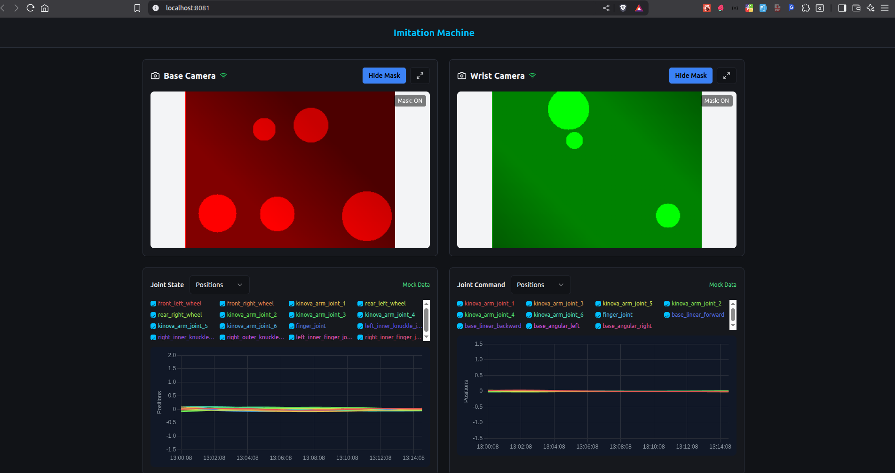

# Robot Teaching Interface

A comprehensive web-based interface for robot teaching and control, featuring real-time data visualization, joint management, and camera feeds. This project consists of a React frontend and Python backend that bridges ROS2 topics with WebSocket connections.

## 🚀 Features

- **Real-time Robot Control**: Interactive interface for joint manipulation and control
- **Camera Integration**: Live camera feeds for visual feedback during robot teaching
- **Data Visualization**: Line charts and real-time plotting of sensor data
- **Training Interface**: Comprehensive training module for robot learning
- **WebSocket Bridge**: Efficient ROS2 to WebSocket communication
- **Modern UI**: Built with React, TypeScript, and shadcn/ui components

## 📁 Project Structure

```text
├── backend/                 # Python backend with ROS2 bridge
│   ├── backend.py          # Main WebSocket server
│   ├── dummy_publisher.py  # ROS2 topic publisher for testing
│   ├── config.json         # Configuration file
│   └── requirements.txt    # Python dependencies
├── src/
│   ├── components/         # React components
│   │   ├── CameraView.tsx  # Camera feed component
│   │   ├── JointManager.tsx # Joint control interface
│   │   ├── LineChart.tsx   # Data visualization
│   │   └── TrainingInterface.tsx # Training module
│   ├── hooks/             # Custom React hooks
│   └── pages/             # Application pages
└── images/                # Screenshots and demos
    ├── image.png          # Project screenshot
    └── ui.gif             # UI demonstration
```

## 🛠️ Technologies Used

### Frontend

- **React 18** - Modern React with hooks
- **TypeScript** - Type-safe development
- **Vite** - Fast build tool and dev server
- **shadcn/ui** - Beautiful and accessible UI components
- **Tailwind CSS** - Utility-first CSS framework
- **WebSocket** - Real-time communication

### Backend

- **Python 3** - Backend server
- **ROS2** - Robot Operating System
- **WebSockets** - Real-time communication
- **OpenCV** - Computer vision
- **NumPy** - Numerical computations

## 📋 Prerequisites

Before running the project, ensure you have:

- **Node.js** (v16 or higher) and npm
- **Python 3.8+**
- **ROS2** (Humble or newer)
- **Conda** (recommended for Python environment management)

## 🚀 Getting Started

### 1. Clone the Repository

```bash
git clone <repository-url>
cd web-interface
```

### 2. Setup Backend Environment

```bash
# Navigate to backend directory
cd backend

# Activate your conda environment (replace 'lerobot' with your environment name)
conda activate lerobot

# Install Python dependencies
pip install -r requirements.txt
```

### 3. Setup Frontend

```bash
# Navigate back to project root
cd ..

# Install Node.js dependencies
npm install
```

## 🎯 Running the Project

The project requires three components to run simultaneously:

### 1. Start ROS2 Topic Publisher (Terminal 1)

```bash
cd backend
c
python3 dummy_publisher.py
```

This publishes dummy data to ROS2 topics for testing the interface.

### 2. Start Backend WebSocket Server (Terminal 2) 
`Note: Run this before frontend because  it uses port 8080 by default and you may face port issue if you run frontend first`

```bash
cd backend
conda activate lerobot
python3 backend.py
```

This starts the WebSocket bridge that connects ROS2 topics to the web interface.

### 3. Start Frontend Development Server (Terminal 3)

```bash
npm run dev
```

The frontend will be available at `http://localhost:5173`

## 🖼️ Screenshots


_Main interface showing robot control and camera feed_


_Interactive demonstration of the user interface_

## ⚙️ Configuration

### Backend Configuration

Edit `backend/config.json` to configure:

- ROS2 topics to subscribe to
- WebSocket server port
- Image compression settings
- Update rates

### Frontend Configuration

Key configuration files:

- `vite.config.ts` - Vite build configuration
- `tailwind.config.ts` - Tailwind CSS customization
- `tsconfig.json` - TypeScript configuration

## 🔧 Development

### Available Scripts

```bash
npm run dev          # Start development server
npm run build        # Build for production
npm run preview      # Preview production build
npm run lint         # Run ESLint
```

### Adding New Components

1. Create components in `src/components/`
2. Use TypeScript interfaces for props
3. Follow the existing naming conventions
4. Add to the appropriate index files for easy imports

### Backend Development

1. Modify `backend.py` for WebSocket handling
2. Update `config.json` for new ROS topics
3. Test with `dummy_publisher.py`

## 🐛 Troubleshooting

### Common Issues

1. **WebSocket Connection Failed**

   - Ensure backend server is running on correct port
   - Check firewall settings

2. **ROS2 Topics Not Received**

   - Verify ROS2 environment is sourced
   - Check topic names in configuration

3. **Frontend Build Issues**
   - Clear node_modules and reinstall: `rm -rf node_modules && npm install`
   - Check Node.js version compatibility

## 🤝 Contributing

1. Fork the repository
2. Create a feature branch: `git checkout -b feature-name`
3. Make your changes and test thoroughly
4. Commit your changes: `git commit -m 'Add feature'`
5. Push to the branch: `git push origin feature-name`
6. Submit a pull request

## 📝 License

This project is licensed under the MIT License - see the LICENSE file for details.

## 🙏 Acknowledgments

- ROS2 community for the robotics framework
- shadcn/ui for the beautiful component library
- React and Vite teams for the excellent development tools

---

For questions or support, please open an issue on the repository.
